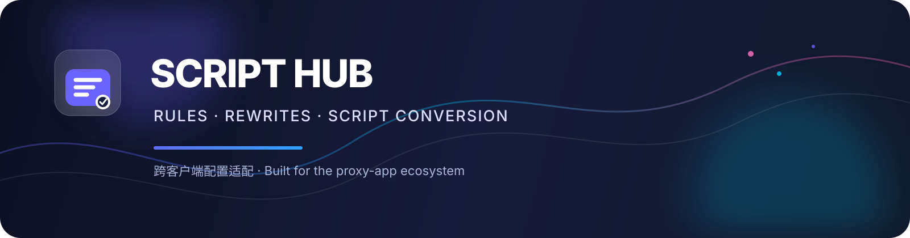

<div align="center">

<a href="https://github.com/ranzhigg/Script-Hub">
  
</a>

# Script Hub

### 规则集 · 重写 · 脚本转换
### Rule Sets · Rewrites · Script Conversion

一个面向代理工具生态的转换与适配工具箱，把不同客户端的配置、脚本和规则集转换成更适合你当前环境的格式。
<br>
An adapter toolkit for the proxy-app ecosystem — convert rules, rewrites and scripts into the format your client actually needs.

<p>
  <a href="https://script.hub"></a>
  <a href="https://github.com/ranzhigg/Script-Hub/wiki"></a>
  <a href="https://github.com/ranzhigg/Script-Hub/blob/main/LICENSE"></a>
  <a href="https://github.com/ranzhigg/Script-Hub"></a>
</p>

<p>
  <a href="#快速开始--quick-start">快速开始</a> ·
  <a href="#支持范围--support-matrix">支持范围</a> ·
  <a href="#loon-script-v2">Loon Script v2</a> ·
  <a href="#社区--community">社区</a>
</p>

</div>

> [!NOTE]
> 这是 `ranzhigg/Script-Hub` 的社区维护分支，基于 [Script-Hub-Org/Script-Hub](https://github.com/Script-Hub-Org/Script-Hub) 持续同步与改进。This is a community-maintained fork that stays close to the upstream project.

## 项目简介 · About

Script Hub 的目标很简单：**让配置迁移不再成为折腾的瓶颈**。你可以把 QX、Surge、Loon、Shadowrocket、Clash 等生态中的规则、重写、模块、插件或脚本，转换为其他客户端能够理解的格式，再按需修改参数、检查兼容性并快速导入。

Script Hub keeps configuration migration practical: convert rules, rewrites, modules, plugins and scripts across the QX, Surge, Loon, Shadowrocket and Clash ecosystems, then adjust arguments, review compatibility and import the result with minimal friction.

## 为什么选择 Script Hub · Why Script Hub

| 能力 | What it gives you |
| --- | --- |
| 🔁 **跨客户端转换** | One source, multiple targets — reduce repetitive manual edits. |
| 🧩 **参数可编辑** | Modify `argument` values and advanced text without downloading a remote module first. |
| 🛡️ **兼容性提示** | Unsupported semantics are reported instead of being silently discarded. |
| ⚡ **快速导入** | Generate installable links for compatible clients and keep the workflow in one place. |
| 🧪 **Beta 先行验证** | Test newer Loon Script v2 capabilities while keeping the stable line independent. |

## 支持范围 · Support Matrix

| 输入 / Source | 输出 / Targets | 说明 / Notes |
| --- | --- | --- |
| QX Rewrite | Surge · Shadowrocket · Loon · Stash | 常用重写规则跨端转换 / Cross-client rewrite conversion |
| Surge Module | Loon · Stash | 模块内容与参数适配 / Module and argument adaptation |
| Loon Plugin | Surge · Shadowrocket · Stash | 插件结构转换 / Plugin conversion |
| Loon Script v2 | Surge · Egern · Shadowrocket · Stash · Loon | 正式版已包含已验证能力，Beta 继续迭代 / Stable includes validated support; Beta continues evolving |
| QX · Surge · Loon · Shadowrocket · Clash 规则集 | Surge · Shadowrocket · Stash · Loon | 规则集解析与目标格式输出 / Rule-set parsing and serialization |
| QX Script | Surge Script | 兼容性转换 / Compatibility conversion |
| 纯文本 / Plain text | 参数修改 · 高级操作 | 适合远程模块的轻量调整 / Lightweight remote-content editing |

支持的目标客户端包括 **Surge、Loon、Shadowrocket、Stash、Egern、LanceX**；具体能力以目标客户端的语法边界和转换提示为准。

## 核心功能 · Features

- 🧭 **一站式转换**：选择输入类型和目标类型，生成可直接使用的配置结果。
- 🛠️ **高级操作**：编辑任意文本、修改参数，适配需要自定义 `argument` 的远程模块。
- 📦 **快速导入**：支持 Shadowrocket、Loon、Stash 等客户端的导入入口。
- 🧱 **规则集处理**：将常见规则集转换为不同客户端可识别的格式。
- 🧬 **脚本适配**：将可表达的脚本逻辑映射到目标客户端；目标不支持时保留诊断信息。
- 🌐 **自托管**：支持本地预览、Node.js 服务和 Docker 部署，适合个人或团队维护。

## 正式版与测试版 · Stable vs Beta

当前正式版已经完成经过验证的 Beta 能力合并，但两条维护线仍然保持清晰分离：

| 发布线 | 入口 | 定位 |
| --- | --- | --- |
| **Stable / 正式版** | `script-hub.js`、`rule-parser.js`、`script-converter.js`、`Rewrite-Parser.js` 及稳定模块 | 面向日常使用，优先保证兼容性与稳定性 |
| **Beta / 测试版** | `*.beta.js` 及 `modules/script-hub.beta.*` | 继续承载新能力验证，单独测试、单独维护 |

也就是说，稳定模块继续调用稳定脚本，Beta 模块继续调用 Beta 脚本；这次合并是稳定化当前能力，不会停止 Beta 后续迭代。正式版与 Beta 的差异应以各自模块入口和文件名为准。

The current Stable line includes the tested Beta capabilities, while Stable and Beta remain separate maintenance lines. Stable modules use the stable runtime files; Beta modules continue to use the `*.beta.js` runtime and remain the place for new capability testing.

## Loon Script v2

当前正式版已包含经过验证的 Loon 3.5.1+ Script v2 转换能力，支持 `request`、`response`、`cron`、`network-changed` 和 `generic` 触发器，并将可映射的 `timeout`、`enable`、`requires_body`、`binary_body_mode` 与脚本参数带到目标格式。Beta 版本继续用于新能力和兼容性改进的验证。

The Stable parser now includes the validated Loon 3.5.1+ Script v2 support: `request`, `response`, `cron`, `network-changed` and `generic` triggers, together with representable timeouts, enable states, body flags and script arguments. The Beta parser remains the line for continued capability and compatibility testing.

兼容性边界：WASM、加密逻辑和脚本正文不会被解密或改写；无法等价表达的条件或参数会给出提示，不会静默丢失。Beta 解析器也避免使用旧版 iOS JavaScriptCore 不支持的正则后行断言，改善 iOS 15/部分 iOS 16 环境的启动兼容性。稳定版与 Beta 版均以官方 `main` 的对应文件为准；客户端缓存仍需单独刷新。

Compatibility boundary: WASM, encrypted logic and script bodies are not decrypted or rewritten. When a target cannot express a source feature, Script Hub reports it instead of silently dropping it. The Beta parser also avoids RegExp lookbehind so older iOS JavaScriptCore environments can start normally. Use the corresponding Stable or Beta module entry when testing a client.

### 本地验证 · Local validation

```bash
npm run test:loon-v2
```

## 快速开始 · Quick Start

### 在线使用 · Use online

1. 打开 [Script Hub](https://script.hub)。
2. 选择输入格式、目标客户端和转换模式。
3. 粘贴远程链接或文本，生成结果后按客户端提示导入。

1. Open [Script Hub](https://script.hub).
2. Choose the source format, target client and conversion mode.
3. Paste a URL or text, generate the result and import it using the client-specific action.

### 本地预览 · Run locally

```bash
git clone https://github.com/ranzhigg/Script-Hub.git
cd Script-Hub
pnpm install
pnpm preview
```

生产服务可使用 `pnpm service` 启动；Docker 用户可以直接使用仓库内的 `Dockerfile` 构建部署。
For a service process, use `pnpm service`; Docker users can build from the included `Dockerfile`.

### 文档与生态 · Docs & ecosystem

- 📖 [使用文档 / Documentation](https://github.com/Script-Hub-Org/Script-Hub/wiki)
- 🧰 [Surge 模块工具 / Surge module tools](https://github.com/Script-Hub-Org/Script-Hub/wiki/%E7%9B%B8%E5%85%B3%E7%94%9F%E6%80%81:-Surge-%E6%A8%A1%E5%9D%97%E5%B7%A5%E5%85%B7)
- 🖥️ [全服务器版（测试中）/ Full-server edition (testing)](https://github.com/Script-Hub-Org/Script-Hub/wiki/%E5%85%A8%E6%9C%8D%E5%8A%A1%E5%99%A8%E7%89%88(%E6%B5%8B%E8%AF%95%E4%B8%AD))

## 社区 · Community

欢迎反馈转换结果、兼容性问题和使用建议。Please share conversion results, compatibility reports and ideas:

- 👥 群组 / Groups: [张佩服](https://t.me/zhangpeifu) · [折腾啥](https://t.me/zhetengsha_group)
- 📢 频道 / Channels: [张佩服](https://t.me/h5683577) · [折腾啥](https://t.me/zhetengsha)
- 🐛 问题反馈 / Issues: [GitHub Issues](https://github.com/ranzhigg/Script-Hub/issues)

## 致谢 · Acknowledgements

感谢所有上游项目、脚本作者和社区贡献者。原有致谢与链接完整保留：

Powered by [_@Chavy‘s_](https://github.com/chavyleung) [Env.js](https://github.com/chavyleung/scripts)<br>
原脚本作者 @小白脸<br>
脚本修改[_@chengkongyiban_](https://github.com/chengkongyiban)<br>
大量借鉴[_@KOP-XIAO_](https://github.com/KOP-XIAO)佬的[resource-parser.js](https://github.com/KOP-XIAO/QuantumultX/raw/master/Scripts/resource-parser.js)<br>
感谢[_@xream_](https://github.com/xream) 佬提供与 [_@keywos_](https://github.com/keywos) 修改 `本项目 Script Hub 网页前端`, [replace-header.js](https://raw.githubusercontent.com/Script-Hub-Org/Script-Hub/main/scripts/replace-header.js)，[echo-response.js](https://raw.githubusercontent.com/Script-Hub-Org/Script-Hub/main/scripts/echo-response.js)，[script-converter.js](https://raw.githubusercontent.com/Script-Hub-Org/Script-Hub/main/script-converter.js)<br>
感谢[_@mieqq_](https://github.com/mieqq) 佬提供的[replace-body.js](https://github.com/mieqq/mieqq/raw/master/replace-body.js), 本项目中已进行修改<br>
感谢[_@Maasea_](https://github.com/Maasea) 佬的指导<br>
项目 logo 感谢 [_@Toperlock_](https://github.com/Toperlock)<br>
插件图标用的 [_@Keikinn_](https://github.com/Keikinn) 佬的 [StickerOnScreen](https://github.com/KeiKinn/StickerOnScreen)项目，以及 [_@Toperlock_](https://github.com/Toperlock) 佬的 [QX 图标库](https://github.com/Toperlock/Quantumult/tree/main/icon)项目，感谢

Thanks to the upstream projects, script authors and community contributors who make this ecosystem possible.

## 许可证 · License

本项目基于 [GNU General Public License v3.0](LICENSE) 发布。
Released under the [GNU General Public License v3.0](LICENSE).

## 赞助 · Support

[Patreon](https://www.patreon.com/scripthuborg)

<div align="center">

<sub>Made for people who enjoy making their tools fit just right. ✨</sub>

</div>
